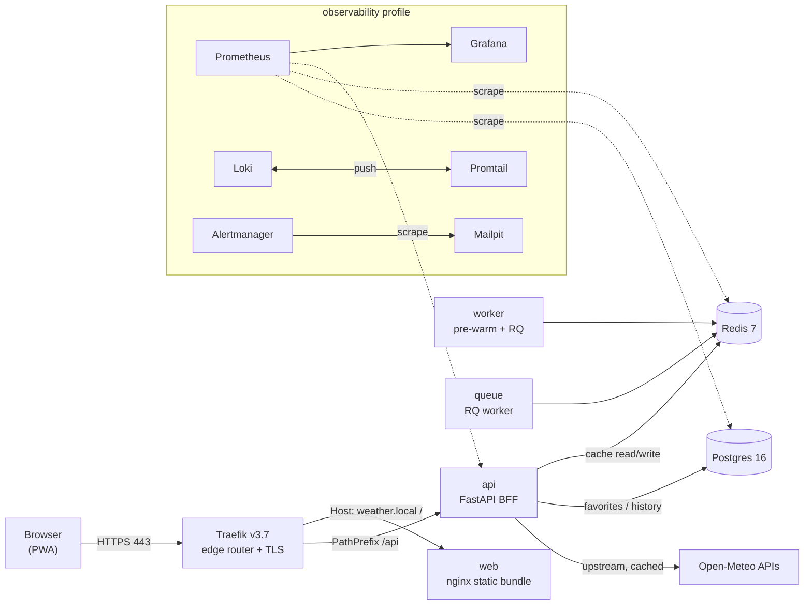

# Over-Engineered Weather App

A deliberately **over-engineered** take on a simple weather PWA. What could have
been a single static HTML file that calls Open-Meteo directly is instead a
production-shaped platform: a reverse proxy, a backend-for-frontend, a cache
layer, a database, a background worker, and a full observability + operations
stack — all wired together with Docker Compose and TLS.

It runs on a Raspberry Pi 4 and is meant as a playground for infrastructure
patterns more than for weather forecasts.

> Data by [Open-Meteo](https://open-meteo.com). No API keys required.

---

## Architecture



The browser only ever talks to the local origin (`/api`); the BFF adds Redis
caching, fixed-window rate limiting, and Postgres-backed favorites/history keyed
by a per-browser `X-Device-Id` header.

---

## Services

All services are grouped into Compose **profiles**. Only the `core` tier has no
profile and starts by default; everything else is opt-in.

### core (6, always on)
| Service | Image | Role |
|---|---|---|
| `traefik` | `traefik:v3.7` | Edge reverse proxy, TLS (local CA), routing, security headers |
| `web` | built (`weather/web:local`) | Multi-stage build: Tailwind + Chart.js + self-hosted Inter, served by nginx |
| `api` | built (`weather/api:local`) | FastAPI BFF: geocode/weather/air-quality/reverse proxy + favorites/history |
| `redis` | `redis:7.4-alpine` | Response cache + rate-limit counters + RQ queue |
| `postgres` | `postgres:16-alpine` | `weather` DB (plus `umami`/`glitchtip` DBs for optional profiles) |
| `worker` | built (`weather/api:local`) | Scheduled pre-warm of Redis cache + health endpoint |

### observability (11)
`prometheus`, `grafana`, `loki`, `promtail`, `node-exporter`, `cadvisor`,
`redis-exporter`, `postgres-exporter`, `alertmanager`, `mailpit`, `uptime-kuma`

### ops (5)
`portainer`, `watchtower` (monitor-only), `adminer`, `ofelia` (cron), `backup` (nightly `pg_dump`)

### queue (1)
`queue` — RQ worker consuming pre-warm jobs on the `weather` queue.

### analytics (1)
`umami` — self-hosted web analytics.

### errors (2)
`glitchtip` + `glitchtip-worker` — self-hosted error tracking.

### storage (1)
`minio` — S3-compatible object storage (see [Caveats](#caveats)).

---

## Prerequisites

- Docker Engine + Compose v2/v5 (developed against Docker 29 / Compose v5)
- `make` and `openssl` (for cert generation and the dashboard auth file)
- A host that resolves `weather.local` (or your chosen hostname) — options:
  - add `<host-ip> weather.local` to `/etc/hosts`, or
  - use mDNS (`<hostname>.local`), or
  - just use `https://localhost`

---

## Quick start

```sh
# 1. Create .env from the example (edit the passwords!)
make env

# 2. Generate a local root CA + leaf cert + dashboard basic-auth file
make certs

# 3. Build the core images (web, api)
make build

# 4. Start the core tier
make up

# 5. Verify
make health            # -> {"status":"ok","redis":true,"database":true,...}
```

Then import `proxy/certs/rootCA.crt` into your OS/browser trust store and open
**https://weather.local** (or `https://localhost`).

Optional tiers:

```sh
make up-obs    # core + observability
make up-ops    # core + ops (Portainer, Adminer, Ofelia, backups, Watchtower)
make up-all    # everything (resource-hungry; mind the disk)
```

---

## Endpoints

Served by Traefik on `:443` (HTTP `:80` redirects to HTTPS). TLS is signed by the
local CA in `proxy/certs/`.

| Host | Service | Auth |
|---|---|---|
| `weather.local`, `pi4.local`, `localhost` | App (PWA) | – |
| `weather.local/api/*` | BFF API | – |
| `traefik.local` | Traefik dashboard | basic (`admin` / `weather`*) |
| `grafana.local` | Grafana | `admin` / `change-me-grafana`* |
| `prometheus.local` | Prometheus | basic |
| `alertmanager.local` | Alertmanager | basic |
| `mail.local` | Mailpit | – |
| `status.local` | Uptime Kuma | – |
| `portainer.local` | Portainer | – |
| `db.local` | Adminer | basic |
| `analytics.local` | Umami | – |
| `errors.local` | GlitchTip | – |
| `minio.local` | MinIO console | – |

\* Default credentials come from `proxy/gen-certs.sh` (`DASH_USER`/`DASH_PASS`) and
`.env` (`GF_SECURITY_ADMIN_*`). **Change them.**

### BFF API

| Method | Path | Description |
|---|---|---|
| GET | `/api/geocode` | City search proxy (cached) |
| GET | `/api/weather` | Forecast proxy (cached) |
| GET | `/api/air-quality` | Air-quality proxy (cached) |
| GET | `/api/reverse` | Reverse geocoding proxy (cached) |
| GET/POST/DELETE | `/api/favorites` | Server-backed favorites (`X-Device-Id`) |
| GET/POST | `/api/history` | Server-backed search history (`X-Device-Id`) |
| GET | `/api/health` | Liveness (checks Redis + Postgres) |
| GET | `/metrics` | Prometheus metrics (internal) |

---

## Makefile reference

| Target | Action |
|---|---|
| `make env` | Create `.env` from `.env.example` (no overwrite) |
| `make certs` | Generate CA/leaf cert + dashboard auth file |
| `make build` / `build-all` | Build core / all images |
| `make up` / `up-obs` / `up-ops` / `up-all` | Start tiers |
| `make down` | Stop and remove containers (keeps volumes) |
| `make ps` / `logs` / `logs-obs` | Inspect |
| `make health` | Curl the BFF health endpoint over TLS |
| `make tls-inspect` | Show served certificate SANs |
| `make backup` | One-off DB backup (ops profile) |
| `make pull` | Pull all base images |
| `make clean` / `clean-all` | Stop (+ delete all volumes — destructive) |

---

## Configuration

Copy `.env.example` to `.env` and edit. Key variables:

| Variable | Purpose |
|---|---|
| `COMPOSE_PROJECT_NAME` | Compose project/prefix (default `weather`) |
| `POSTGRES_USER` / `POSTGRES_PASSWORD` / `POSTGRES_DB` | Database |
| `BACKUP_RETENTION` | Number of nightly backups to keep |
| `RATE_LIMIT_REQUESTS` / `RATE_LIMIT_WINDOW` | BFF rate limiting |
| `CORS_ORIGINS` | Allowed origins (empty = same-origin only) |
| `WORKER_CITIES` / `WORKER_INTERVAL_SEC` | Pre-warm target list + cadence |
| `GF_SECURITY_ADMIN_USER` / `GF_SECURITY_ADMIN_PASSWORD` | Grafana admin |
| `UMAMI_APP_SECRET` / `GLITCHTIP_SECRET_KEY` / `MINIO_*` | Secrets for optional profiles |

Secrets are **not** committed: `.env`, `proxy/certs/`, and `proxy/dynamic/users`
are git-ignored.

---

## Caveats

- **Disk footprint is large.** The full stack is ~10 GB of images plus volumes on
  top of the base OS. Start only the tiers you need; `up-all` on a small SD card
  can fill the disk.
- **MinIO**: the upstream `minio/minio` Docker image has been removed from Docker
  Hub. The `storage` profile points at a community mirror and is not required for
  the app (nothing uses S3 yet).
- **Traefik API version**: on very new Docker engines, the bundled Docker client
  in older Traefik watches defaults to API 1.24 and fails; this repo pins
  `DOCKER_API_VERSION` and uses Traefik v3.7.
- **Local CA only.** The leaf certificate is self-signed by `proxy/certs/rootCA.crt`;
  import it to avoid browser warnings. Not suitable for public exposure.
- **Basic auth defaults are weak.** Change `DASH_PASS` and the Grafana password
  before running anything reachable by others.

---

## Project layout

```
.
├── app/                 # PWA source (index.html, sw.js, manifest, icon)
├── web/                 # nginx static build (Tailwind, Chart.js, Inter)
├── api/                 # FastAPI BFF + shared image for worker/queue
├── worker/              # pre-warm scheduler + RQ worker/producer
├── proxy/               # Traefik static/dynamic config + cert generation
├── db/init/             # Postgres init (databases + schema)
├── observability/       # Prometheus, Grafana, Loki, Promtail, Alertmanager configs
├── ops/                 # Ofelia cron + backup script
├── compose.yaml         # 27-service stack (profiles)
├── Makefile             # task runner
└── .env.example         # environment template
```

---

## License

MIT © 2026 Lukas Axelborn
